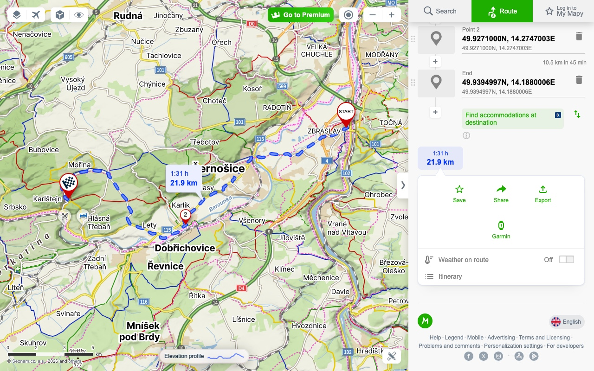
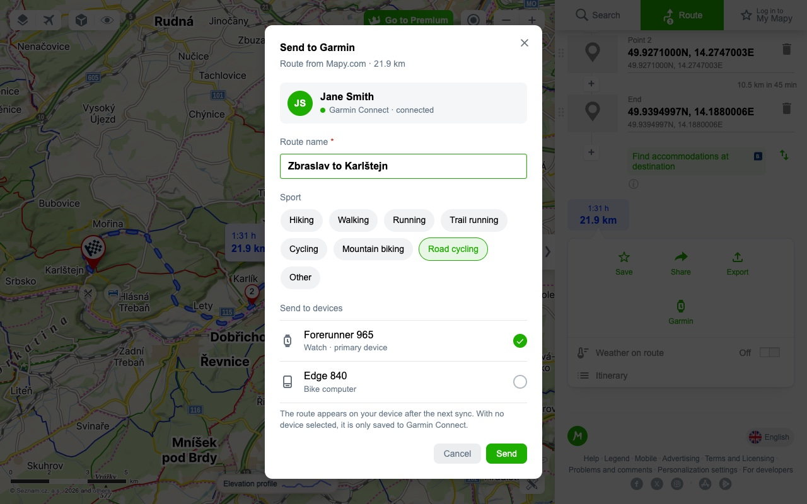

# GarSync – Send Mapy.com routes to Garmin

A Google Chrome extension that sends a route planned on [Mapy.com](https://mapy.com) to Garmin Connect and straight to your Garmin watch or bike computer in one click. No GPX downloads, no detour through your phone.

> GarSync is an unofficial add-on. It is not made or endorsed by Garmin Ltd. or Seznam.cz, a.s.

## Install (developer mode)

1. Open `chrome://extensions` in Chrome.
2. Turn on **Developer mode** (top right).
3. Click **Load unpacked** and pick the `extension` folder of this project.
4. Optionally pin the extension to the toolbar (puzzle icon → pin next to GarSync).
5. Make sure you are signed in at [connect.garmin.com](https://connect.garmin.com) in the same Chrome profile.

## Usage

1. On Mapy.com, plan a route in the route planner, or open a saved route from My Maps or a shared link (`mapy.com/s/…`).
2. In the route panel, click the **Garmin** icon in the new row below Save / Share / Export. That row belongs to the extension; Mapy.com's own row is left untouched.

   

3. The top of the dialog shows which Garmin Connect account is connected. If you are not signed in, click **Sign in**, sign in in the new tab and come back to Mapy.com. The dialog refreshes on its own.
4. Check the route name (required) and the sport, pick your devices and click **Send**.

   

5. The route is saved to Garmin Connect (Training → Courses) and queued for the selected devices. It appears on the device after the next sync, which runs on its own through the phone app or over Wi-Fi.

The extension remembers your device selection, so next time you just click the button and then Send (or press Enter).

## How it works

- **Mapy.com** (`content/mapy.js`, `content/mapy-bridge.js`, `lib/mapy-route.js`): reads the route the planner is showing (new, saved or shared) and downloads its GPX through the same export the Mapy.com Export button uses. If the page state is not available, it falls back to the points in the URL. The route type (walking, cycling, MTB…) pre-selects the Garmin sport.
- **Garmin Connect** (`lib/garmin-api.js`): requests use your existing session and the same internal endpoints as the Garmin Connect website. The background worker calls them directly, with no extra tab; Garmin Connect is behind Cloudflare, which only accepts API requests with the headers of its own web app, so a session rule sets Origin, Referer and Sec-Fetch-* on these background requests (and only on them). If direct calls do not work, the extension falls back to running them inside a connect.garmin.com tab (`content/garmin.js`) that it opens in the background and closes again.
  0. `GET /gc-api/userprofile-service/socialProfile` and `GET /gc-api/device-service/deviceregistration/devices`: your display name and devices,
  1. `POST /gc-api/course-service/course/import`: Garmin parses the GPX,
  2. `POST /gc-api/course-service/course`: saves it as a private course,
  3. `POST /gc-api/device-service/devicemessage/messages`: queues it for your devices.
- **Toolbar panel** (`popup/`): clicking the extension icon opens a small panel with a quick how-to, a link to Mapy.com, project links and a support button.
- **Background** (`background.js`): connects the dialog with Garmin Connect and decides between direct mode and the tab fallback. The mode is decided on the read-only account lookup, so a route is never uploaded twice.

The extension sends data nowhere else and stores nothing except your device selection (locally in Chrome).

## Limitations

- Garmin has no public API for individuals, so the extension relies on the internal endpoints of the Garmin Connect website. If Garmin changes them, the extension needs an update.
- The route has to be open in the Mapy.com route planner (the panel with Save / Share / Export). GPX tracks imported into My Maps are not supported yet.
- Public transport routes are not supported.

## Publishing to the Chrome Web Store

Everything for the store submission is in the [store](store) folder: listing texts and form answers ([LISTING.md](store/LISTING.md)), the privacy policy ([privacy-policy.html](store/privacy-policy.html)) and the graphics ([store/assets](store/assets)). Build the upload package with:

```bash
./store/build.sh
```

## Privacy

See the [privacy policy](https://jhnngrg.github.io/garsync/store/privacy-policy.html). In short: no server, no tracking, data goes only from your browser to your own Garmin Connect account.

## License

[MIT](LICENSE). Issues and pull requests are welcome.

## Tests

```bash
node extension/test/mapy-route.test.mjs
node extension/test/background-modes.test.mjs
```
